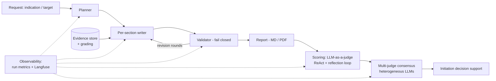

# AI Pharma Research Platform

> A three-phase, production-grade platform that brings LLM agents into pharmaceutical R&D decision-making — from a fast-delivered query toolset, to a config-driven multi-agent deep-research engine, to LLM-as-a-judge project scoring that evolved into multi-judge consensus evaluation.

[中文版](README_CN.md)

> **Proprietary notice.** The codebase behind this project is a private, company-internal implementation. This repository documents the work publicly — architecture, methodology, report templates, and sanitized sample outputs. Source code is not published.

---

## What this is

A platform built over three phases to move pharmaceutical research teams from hours of manual desk research to trustworthy, LLM-assisted indication and target assessment:

1. **A query toolset** (Phase 1) — delivered quickly so the business gained value immediately while the agent platform matured.
2. **A config-driven deep-research agent** (Phase 2) — autonomously writes multi-chapter indication / target research reports with evidence-graded, citation-verified content.
3. **A project-scoring subsystem** (Phase 3) — LLM-as-a-judge evaluation of target–indication proposals, evolved into multi-judge consensus with heterogeneous LLMs.

## Why this matters

Pharma research teams face a daily bottleneck: indication and target research requires hours of desk work across clinical trials, competitor pipelines, standard-of-care regimens, and expression data — and the conclusions feed **multi-million-dollar project-initiation decisions**.

Out-of-the-box LLM agents are untrustworthy for this task: **they fabricate citations, treat preprint noise as evidence, and fail silently**. The result is a tool nobody can stake a decision on.

This project's thesis: *the value of an LLM research agent is not generation — it is the engineering that makes the generated output verifiable, reproducible, and defensible.* Every phase was built around that thesis.

## Platform at a glance

| Phase | Deliverable | Status |
|---|---|---|
| 1 | Online target/indication query toolset (bioinformatics MCP × Streamlit) | In production use |
| 2 | Config-driven multi-agent deep-research engine | In production use |
| 3 | LLM-as-a-judge scoring → multi-judge consensus | In production use |

Reports have been produced across multiple oncology indications (colorectal, pancreatic, ovarian, breast cancer).

---

## Phase 1 — Fast delivery: query toolset

A Streamlit-orchestrated, bioinformatics-MCP-driven toolkit (clinical trial results, competitor pipelines, SOC regimens, normal/tumor tissue expression, new-drug target analysis, target pre-screening) was shipped early so the department got working value before the agent platform matured. The pattern that paid off later: **adding a business capability = adding an MCP tool**, without touching the core orchestration loop. That agility model became the foundation of Phase 2's tool ecosystem.

## Phase 2 — Config-driven deep-research agent

The core research engine. Instead of hard-coding report structure, **configuration documents fix the chapter skeleton and required elements** for each report type (indication research / target research / combined). Each configuration defines: the report's parts and chapters, per-chapter goals and content types, the required elements the validator checks against, and search/evidence-acquisition strategies (authoritative sources first). Changing a report's structure or standards is a **document edit, not a code change**.

**Pipeline:** planner → per-section writer → validator → revision rounds, fed by a shared evidence store.

**Why the output is trustworthy:**

- **Stable, multimodal output** — chapters, elements, and evidence format are contract-constrained, so reports come out consistent regardless of input topic.
- **Evidence-graded content** — sources are parsed into a structured evidence store; preprint noise (e.g. medRxiv) is filtered and down-graded relative to authoritative sources; template sections carry authority-source tool instructions.
- **Citation integrity** — citation numbering is rebuilt end-to-end (local → global mapping, renumbered by order of appearance); dangling citations are detected and dropped with counts; an offline **citation↔claim semantic consistency checker** verifies every claim is actually supported by the cited source — eliminating the classic "cites something that doesn't say that" failure.
- **Fail-closed validation** — the validator rejects malformed output, triggers structured-format retries, and the revision loop has a fallback gate plus no-improvement early exit. Quality gates, not vibes.
- **Context-budget engineering** — a four-level degradation ladder (warn → compress → emergency) keeps long multi-chapter runs within budget without silently dropping required elements.
- **Full observability** — per-chapter runtime reports (score / rounds / parse errors / dangling citations / stop reason / wall time) plus Langfuse tracing make every run auditable.

## Phase 3 — LLM-as-a-judge → multi-judge consensus

Project-initiation scoring for target–indication proposals, again **config-driven: scoring standards and dimensions are fixed in documents**, not code.

**v1 — single-judge LLM scorer:**
- Runtime reasoning core: a rollout closed loop executing ReAct + reflection iterations.
- Loop safety by design: a maximum-iteration cap **plus** an LLM self-evaluation score threshold — either one stops the loop, so the system can never spin forever.
- Multi-dimensional scores per config, parsed from the judged report into a structured scoring report.

**v2 — multi-judge consensus:**
- **Heterogeneous LLMs** (different vendors/models) score independently with no tool interference, then deliberate and converge — removing the single-model bias any one judge carries.
- Consensus combines confidence-weighted soft voting, disagreement detection, and a safety veto policy (hard rules that no judge vote can override — e.g. clinical holds).
- Every decision carries a complete audit trail (per-judge scores, weights, veto events, final consensus score).

**Where this is heading:** distill the capabilities of multiple heterogeneous flagship models into a **small dedicated scoring model** — industrial cost and latency without losing assessment quality.

---

## Sanitized sample reports

Two full reports generated by the platform, published in sanitized form:

  
  
   
  
  

| Report | Link | What to look for |
|---|---|---|
| Pancreatic cancer research | [pancreatic-cancer-research-report.pdf](samples/pancreatic-cancer-research-report.pdf) (8.9 MB) | Chapter structure per template · data tables · citation numbering · clinical trial landscape |
| Colorectal cancer research | [colorectal-cancer-research-report.pdf](samples/colorectal-cancer-research-report.pdf) (6.6 MB) | Same template → different indication, stable structure · SOC regimens · market & BD landscape |

These reports were reviewed page-by-page and confirmed to contain only **public literature and market information** (clinicaltrials.gov, WHO GLOBOCAN, SEER, peer-reviewed journals, public news). No internal strategy, pipeline, or company-confidential content. See the [desensitization statement](samples/README.md).

## Report templates as proof

The report template **is the product**: configuration documents are what fix chapter skeletons, required elements, and evidence standards. The templates themselves are internal configurations and are not published, but their design is what makes the platform config-driven — the pipeline consumes YAML documents that fully specify chapter skeletons, per-chapter goals and content types, required elements, and search strategies, with zero report structure hard-coded.

## Architecture at a glance

## Tech stack

Python 3.11 · Pydantic v2 / pydantic-settings · MCP (Model Context Protocol) · Streamlit · httpx · Langfuse (observability) · weasyprint (PDF) · pytest

## Roadmap

- Distill heterogeneous flagship judges into a small dedicated scoring model
- Broaden report types beyond oncology indications/targets
- Multi-language report output (currently Chinese-centric, driven by source domain)

## Contact

This is a proprietary internal platform; the codebase is not public. For details or collaboration, see the repository root [README](../../README.md).
