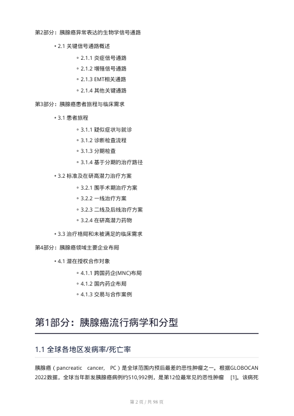
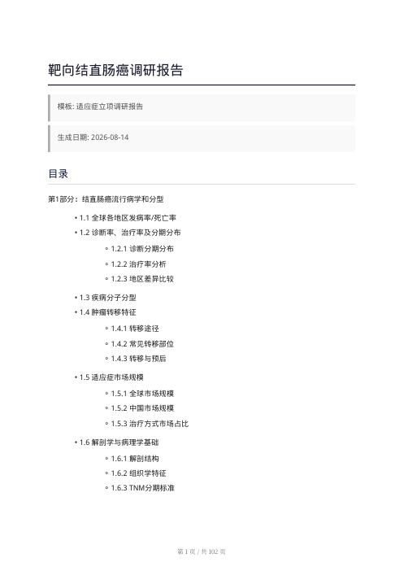
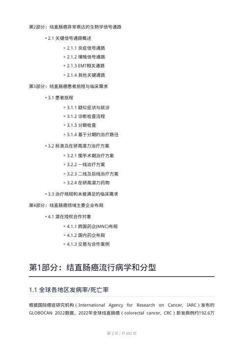
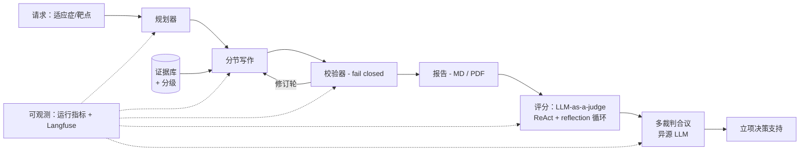

# AI 制药调研与立项平台

> 三阶段、已投产的制药决策 AI 平台：从快速交付的查询工具集，到配置驱动的多智能体深度调研引擎，再到 LLM-as-a-judge 立项评分（已演进为多裁判合议）。

[English](README.md)

> **脱敏声明**：本项目代码为公司内部私有实现，本仓库仅公开架构、方法论、报告模板与脱敏样本，源代码不公开。

---

## 一句话定位

制药立项决策 AI 平台（调研 + 评分），三阶段全部投产。

## 为什么值得看

制药调研的痛点是**"小时级案头工作 × 千万级立项决策"**：适应症/靶点调研要靠人工翻阅临床试验、竞品管线、SOC 方案、表达谱数据，结论直接决定项目是否立项。

裸 LLM 在这里不可用：**会编造引用、把 preprint 噪声当证据、失败时静默**——没人敢把决策押在上面。这个平台的核心论点是：*LLM 调研 Agent 的价值不在"生成"，而在让产出可验证、可追溯、可辩护的工程。*

它同时考验两条能力线：**LLM Agent 工程**（多智能体编排、校验闭环、引用可信、可观测）和**制药业务理解**（报告章节契约、证据分级、立项评分标准）。

## 三阶段

| 阶段 | 交付物 | 状态 |
|---|---|---|
| 一 | 在线靶点/适应症查询工具集（生信 MCP × Streamlit） | 已投产 |
| 二 | 配置驱动的多智能体深度调研引擎 | 已投产 |
| 三 | LLM-as-a-judge 立项评分 → 多裁判合议 | 已投产 |

已产出覆盖多个瘤种的适应症调研报告（结直肠癌、胰腺癌、卵巢癌、乳腺癌）。

---

## 阶段一 · 快速交付（一段带过）

先用 Streamlit + 生信 MCP 交付查询工具集（临床试验结果、竞品分析、SOC 方案、组织表达、新药靶点分析、靶点初筛），让业务部门第一时间用上。核心模式：**加业务能力 = 加一个 MCP 工具**，不动编排主循环——这个敏捷模式直接成了阶段二工具生态的基础。

## 阶段二 · 配置驱动的深度调研 Agent

报告结构不写死在代码里，而是**用配置文档固定章节骨架与必需要素**（适应症型/靶点型/联合型各有模板）。每个配置定义：报告的分部与章节、每章目标与内容类型、校验器检查的必需要素清单、以及检索与证据获取策略（权威源优先）——改报告结构或标准是**改文档，不是改代码**。

**流水线**：规划 → 分节写作 → 校验 → 修订轮，共用一套证据存储。

**产出为何可信：**

- **稳定输出**：章节、要素、证据格式受契约约束，换任何输入主题结构都稳定
- **证据分级**：来源入结构化证据库；medRxiv 等 preprint 噪声过滤并降级；模板各节内置权威源工具指令
- **引用完整性**：引用编号端到端重建（local→global 映射、按出现顺序重编号）；断引检测并计数丢弃；离线**引用↔论断语义一致性校验**确保每条论断确实被所引文献支持——消灭"引用了但根本没这么说"的经典幻觉
- **Fail-closed 校验**：校验器对畸形输出拒绝放行、触发结构化重试；修订轮带回退闸门 + 无改进早停——质量闸门，不是玄学
- **上下文预算工程**：四级降级梯（预警→压缩→应急）让长章节运行不超预算、不静默丢要素
- **全链路可观测**：每章运行指标（得分/轮次/解析错误/断引数/停止原因/耗时）+ Langfuse 追踪，每次运行可审计

## 阶段三 · LLM-as-a-judge → 多裁判合议

立项评分同样**配置驱动：打分标准与维度固定在文档里**，不进代码。

**v1 单裁判**：ReAct + reflection 的 rollout 闭环推理核；**最大轮次上限 + LLM 自评分阈值**双重防死循环；按配置多维度打分，解析出结构化评分报告。

**v2 多裁判合议**：
- **异源多个 LLM**（不同厂商/模型）无工具干扰地独立打分，再合议收敛——消除单一模型偏见
- 合议 = 置信度加权软投票 + 分歧度检测 + 安全一票否决（硬规则，任何裁判票都不可覆盖，如临床 hold）
- 每个决策带完整审计链（各裁判分、权重、否决事件、最终合议分）

**演进方向**：把多个异源旗舰模型的能力**蒸馏到小尺寸专用评分模型**——工业化成本与延迟，不损失评估质量。

---

## 脱敏样本报告

平台产出的两份完整报告（脱敏后公开）：

  
  
   
  
  

| 报告 | 链接 | 看什么 |
|---|---|---|
| 胰腺癌调研 | [pancreatic-cancer-research-report.pdf](samples/pancreatic-cancer-research-report.pdf)（8.9 MB） | 模板规定的章节结构 · 数据表 · 引用编号 · 临床试验格局 |
| 结直肠癌调研 | [colorectal-cancer-research-report.pdf](samples/colorectal-cancer-research-report.pdf)（6.6 MB） | 同一模板换适应症结构依然稳定 · SOC 方案 · 市场与 BD 格局 |

两份报告已逐页审查，内容仅为**公开文献与市场信息**（clinicaltrials.gov、WHO GLOBOCAN、SEER、同行评审期刊、公开新闻），不含内部策略、管线或公司机密。详见 [脱敏声明](samples/README.md)。

## 模板即产品力

报告模板**就是产品**：配置文档固定章节骨架、必需要素与证据标准。模板本身为内部配置，不公开；但正是它的设计让平台实现配置驱动——流水线消费的 YAML 文档完整规定章节骨架、每章目标与内容类型、必需要素与检索策略，报告结构零硬编码。

## 架构总览

## 技术栈

Python 3.11 · Pydantic v2 / pydantic-settings · MCP · Streamlit · httpx · Langfuse · weasyprint (PDF) · pytest

## Roadmap

- 异源旗舰裁判蒸馏 → 小尺寸专用评分模型
- 报告类型扩展到肿瘤适应症/靶点之外
- 多语言报告（当前以中文为主，由数据源决定）

## 联系

本项目为私有内部平台，代码不公开。合作或详情见仓库根 [README](../../README_CN.md)。
