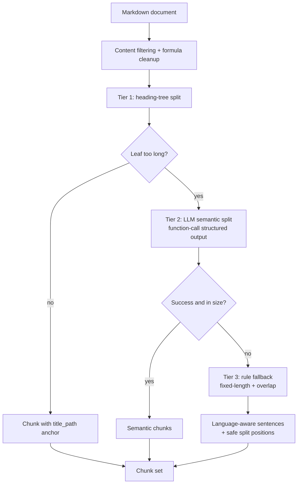
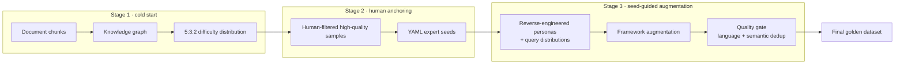
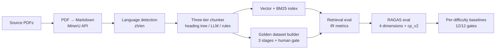

# RAG Offline Pipeline — Production Retrieval for Report-Interpretation Agents

> The offline RAG backbone behind report-interpretation agents for anti-aging products: a document chunker with three-tier degradation, a three-stage golden-dataset builder, and a retrieval/evaluation system that treats badcase attribution as science — pre-registered ablation experiments, single-variable baselines, and 12/12 metric gates passed after one month of iteration.

[中文版](README_CN.md)

> **Proprietary notice.** The codebase behind this project is a private, company-internal implementation. This repository documents the work publicly — architecture, methodology, evaluation numbers, and sanitized chunk examples. Source code is not published.

---

## What this is

Two generations of an offline RAG system powering an anti-aging product line's report-interpretation agents (an epigenetic-clock blood-report agent first, then a methylation-clock inspection-report agent):

- **v1** — a monolithic pipeline that *got the RAG chain working*: rule-based chunking, hand-built evaluation sets, keyword-matched test data.
- **v2** — a modular rebuild (transform / chunk / index / evaluate) that upgraded every stage to **measurable, degradable, reproducible** engineering: LLM semantic chunking with a three-tier fallback ladder, a three-stage automatic golden-dataset pipeline, and a dual-dimension evaluation system with per-difficulty production baselines.

The v1→v2 arc is the story: from "it runs" to "every claim about the system's quality is backed by a number, and every number has a pre-registered definition."

The online counterpart — the streaming NLU→DM→NLG orchestration this pipeline feeds — is documented in [Report Interpretation Agent](../report-interpretation-agent/).

## Why this matters

RAG is deceptively easy to demo and deceptively hard to run in production. The offline side (documents → chunks → index → evaluation) hides three classes of failure that a green demo never surfaces:

1. **Retrieval misses masked by metrics** — cross-lingual corpora (Chinese queries, English literature) silently drop ground-truth chunks from the top-5 because the reranker scores with the wrong query language. Nothing crashes; the answer is just quietly wrong.
2. **Judge metrics that structurally under-score** — the stock RAGAS context_precision judge requires *one chunk to fully support the whole answer*; multi-hop answers by construction get partial support from several chunks, so real retrieval quality reads as failure (our data: 86.5% of "low-score" samples had their ground truth already in the top-5).
3. **Baselines that drift with infrastructure** — migrating schemas, merging collections, or expanding the corpus (52×) silently rewrites BM25 score distributions and invalidates every historical gate.

> The thesis: *the value of a production RAG system is not retrieval — it is the evaluation engineering that makes retrieval quality measurable, attributable, and regression-proof.*

---

## System at a glance

| Generation | Deliverable | Status |
|---|---|---|
| v1 | Monolithic offline RAG (rule chunking, hand-built evals) | In production use |
| v2 | Modular pipeline: LLM chunking + golden dataset + dual-dimension evals + baselines | In production use, 12/12 gates |

---

## 1 · Chunking — a three-tier degradation ladder

The chunker treats "any document must yield chunks" as a hard guarantee. Three tiers, each with a defined fallback:

- **Tier 1 — heading-tree split.** Documents are parsed into a section hierarchy (H1/H2/H3) via regex; every chunk carries its `title_path` (e.g. `Document > Results > EWAS of smoking`) as a semantic anchor. Leaves under the size limit become chunks directly.
- **Tier 2 — LLM semantic split.** Over-long leaves go to an LLM that returns split points as **structured function calls** (not free text), with async concurrency and semaphore rate limiting.
- **Tier 3 — rule-based fallback.** If the LLM fails or still returns over-long output, a deterministic splitter takes over: paragraph accumulation + overlap stitching + language-aware sentence splitting + safe split positions (never inside a formula or mid-sentence).

Every tier failure degrades to the next; no unhandled exception can stop a document from producing chunks.

## 2 · Golden dataset — a three-stage build pipeline

Test-set construction is where RAG projects quietly cheat. Here it is a pipeline with a human gate in the middle:

- **Stage 1 — cold start.** RAGAS `TestsetGenerator` + a knowledge graph, generating queries at a **fixed 5:3:2 difficulty distribution** (single-hop 50% / multi-hop specific 30% / multi-hop abstract 20%).
- **Stage 2 — human anchoring.** Humans filter the cold-start output into a YAML expert seed set.
- **Stage 3 — seed-guided augmentation.** The distribution of the seeds is reverse-engineered into personas + query distributions, then the framework augments from the seeds — with a quality gate (language check + embedding-based semantic dedup > 0.85) — into the final golden dataset.

**Bilingual by design:** PDFs go through MinerU (online API, batched, resumable) into Markdown; language is detected by Chinese-character ratio; BM25 tokenization uses jieba (zh) / nltk (en). One pipeline serves both languages.

## 3 · Retrieval tuning as attribution science

The August arc — the part that turned "we should fix retrieval" into a defensible result:

**Step 1 — triage before fixing.** 58 zero-score samples were split into three classes by root cause, *before any code changed*:
- **Class A (29)** — true retrieval misses: ground truth existed in the corpus but not in top-5. Dominant cause: cross-lingual drift (GT English → retrieved Chinese) in 24/29.
- **Class B (29)** — metric artifacts: ground truth already retrieved, but the judge's "one chunk must fully support the answer" standard scored partial support as 0 (72% of cases).
- **Class A′ (7)** — IR false negatives: the judge accepted chunks from the ground-truth document that the chunk-level IR metric could not see.

**Step 2 — pre-registered ablation.** Ten hypotheses, six configurations (pool width × rerank query language), judgment criteria written *before* the runs. Four stages with pruning rules; a configuration had to pass repair ≥18/29, regression ≤2, and CN-ground-truth recall loss ≤2pp to survive.

**Step 3 — the verdict, quantified.** The winning configuration (wide candidate pool + language-split bilingual rerank) came from direct measurement of **language suppression**: scoring English chunks with an English query +5.4pp, while scoring Chinese chunks with an English query *crushed them to one third* (−10.6pp). Cross-lingual capable ≠ cross-lingual unbiased — and the fix was scoring each chunk in its own language.

| Configuration | Repair (A-class, /29) | Regression (B-class) | CN GT recall | Verdict |
|---|---|---|---|---|
| narrow + zh rerank (baseline) | 2 | 0 | 0.712 | baseline |
| narrow + en rerank | 21 | 1 | 0.515 (−19.7pp) | ❌ kills CN |
| wide + zh rerank | 3 | 1 | 0.780 | ❌ no repair |
| wide + en rerank | 24 | 3 | 0.492 (−22.0pp) | ❌ kills CN |
| **wide + split bilingual rerank** | **21** | **1** | **0.765 (+5.3pp)** | ✅ **winner** |

Shipped the same day, behind a single environment variable for minute-level rollback.

## 4 · Evaluation engineering & production baselines

**Dual-dimension evaluation:** independently implemented IR metrics (Hit@k / Recall@k / Precision@k / MRR / NDCG@k, binary relevance, dedup-guarded) measure pure retrieval; four RAGAS dimensions (context_precision / context_recall / faithfulness / answer_relevancy) measure generation quality. Both grouped overall *and* by query difficulty.

**Fixing the metric, not gaming it** — when triage showed Class B was a judge artifact, the fix was an adapted context_precision judge (**cp_v2**): a chunk earns credit if it contributes to *any part* of the answer — with few-shot examples including a negative "vague-summary" case to prevent grade inflation. Validated with anchor tests before adoption (positive group 14/17, negative group mean ≤0.2, judge variance 0.0 across 3 runs), and observed in dual-reporting mode before becoming the acceptance metric.

**Two-stage baseline system** — different task types get different gates:

- **Stage 1, IR diagnostic tier** — per-query-type thresholds, derived as (RAGAS baseline − known cross-lingual exact-match penalty: single ~0pp, intra ~18pp, inter ~23pp). Cheap, signals where to iterate.
- **Stage 2, RAGAS acceptance tier** — per-query-type production gates (e.g. cp(v2): single ≥0.87 / intra ≥0.84 / inter ≥0.82), thresholds = measured mean − 1σ. Historical rounds frozen, never retroactively re-graded.

**Safety rails:** faithfulness < 0.93 triggers a rollback review; two independent rollback switches (rerank strategy / cp_v2) restore the previous behavior in minutes.

## Results — one month, one frozen dataset

| Metric | Start (#7) | Final (#11) | Δ |
|---|---|---|---|
| Hit@5 | 0.6818 | **0.9476** | +26.6pp |
| Recall@5 | 0.5717 | **0.8106** | +23.9pp |
| MRR | 0.5293 | **0.8478** | +31.9pp |
| NDCG@5 | 0.5021 | **0.7729** | +27.1pp |
| context_precision (v2) | 0.4992 (v1) | **0.8662** | +36.7pp |
| Low-score samples | 193 | **134** | −30.6% |

Acceptance gates: 8/12 → 11/12 → **12/12, first full pass**. Full tables and per-difficulty gates: [samples/eval-numbers.md](samples/eval-numbers.md).

Beyond the golden-dataset arc, the 52× full-corpus migration surfaced and fixed real infrastructure debt: a deterministic document-identity scheme replacing random UUIDs, a 15-field schema evolution with three-layer dedup (33 unit tests), and BM25 at scale — where the measured conclusion was that merged-collection cost lands in *score precision*, not speed.

## Architecture

## Tech stack

Python · RAGAS · Milvus + pymilvus · MinerU · Langfuse · jieba / nltk · vLLM · DashScope embeddings & rerank

## Roadmap

- Faithfulness guardrail (< 0.93 rollback trigger) promoted into the routine eval flow
- cp_v2 upgrade: split reference answers into sub-answers for per-part judgment
- Remaining 15/286 retrieval misses: 14 are English-chunk rerank precision (not recall) — targeted rerank tuning
- Rerank token-cost reduction for wide candidate pools

## Sanitized samples

This system's outputs are metrics and chunks, not reports — published as [evaluation numbers](samples/eval-numbers.md) and [chunk structure examples](samples/chunk-examples.md) ([中文版](samples/eval-numbers_CN.md) / [中文版](samples/chunk-examples_CN.md)). See the [desensitization statement](samples/README.md) ([中文版](samples/README_CN.md)): numbers are system metrics only; chunk excerpts are short fragments from published academic papers; no source code, queries, answers, or internal materials are published.

## References

The golden-dataset builder and evaluation metrics in this project are built on a forked RAGAS framework. Primary sources:

#### 1. Core theory of the query-evolution mechanism (Evol-Instruct)

> Xu, C., Sun, Q., Zheng, K., Geng, X., Zhao, P., Feng, J., Tao, C., & Jiang, D. (2024). WizardLM: Empowering Large Language Models to Follow Complex Instructions. In *International Conference on Learning Representations (ICLR 2024)*. [https://arxiv.org/abs/2304.12244](https://arxiv.org/abs/2304.12244)

#### 2. Evaluation framework and metric system (RAGAS)

> Es, S., James, J., Espinosa Anke, L., & Schockaert, S. (2024). RAGAS: Automated Evaluation of Retrieval Augmented Generation. In *Proceedings of the 18th Conference of the European Chapter of the Association for Computational Linguistics (EACL 2024): System Demonstrations* (pp. 150–155). Association for Computational Linguistics. [https://aclanthology.org/2024.eacl-demo.16/](https://aclanthology.org/2024.eacl-demo.16/)

#### 3. Knowledge-graph-based testset generation (Ragas Testset Generator technical specification)

> Exploding Gradients. (2024). *Testset Generation for RAG: Knowledge Graph based Approach*. Ragas Documentation. [https://docs.ragas.io/en/stable/concepts/test_data_generation/rag/](https://docs.ragas.io/en/stable/concepts/test_data_generation/rag/)

## Contact

For details or collaboration, see the repository root [README](../../README.md).
