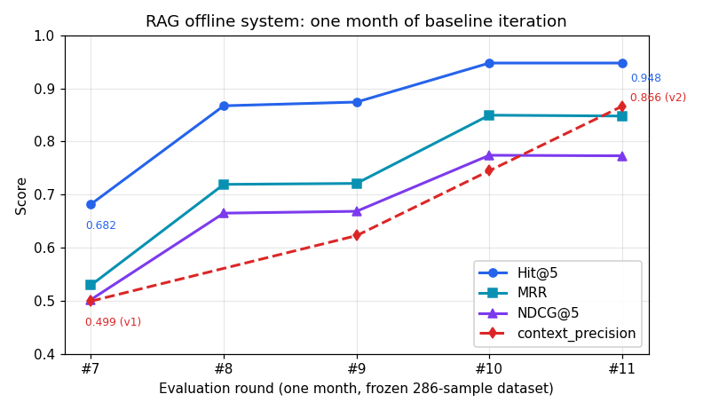

# RAG 离线系统 — 报告解读 Agent 的生产级检索底座

> 抗衰产品报告解读 agent 背后的 RAG 离线管线，两期全部投产：一期把链路跑通，二期把每个环节升级成**可度量、可降级、可复现**的工程系统——三级降级切分、三阶段测评集构建、预注册消融实验驱动的检索调优、分难度生产基线，一个月迭代 12/12 指标全达标。

[English](README.md)

> **脱敏声明**：本项目代码为在职期间私有实现，本仓库仅公开架构、方法论、评测数字与脱敏样本，源代码不公开。

---

## 一句话定位

给抗衰产品线的报告解读 agent 做离线 RAG 底座：文献 PDF → 结构化切分 → 向量/BM25 入库 → 测评集构建 → 检索与生成质量双维评测 → 分难度基线验收。

## 为什么值得看

做业务的人都知道：用户问 agent"我的报告说明了什么"，agent 答错一次，信任就没了。RAG 项目 demo 容易、上线难——**离线侧**藏着三类 demo 永远不会暴露的失败：

1. **检索脱靶被指标掩盖**：中英混排语料里，中文提问配英文文献，精排器用错了语言打分，正确答案被挤出 top-5——不报错、不崩溃，只是悄悄答错。
2. **评测口径结构性低估**：标准 context_precision 裁判要求"一个 chunk 完整支撑整个答案"，多跳问题的答案天然由多个 chunk 拼成——检索明明对了，分数却显示失败（实测：86.5% 的低分样本，GT 早就在 top-5 里）。
3. **基线随基础设施漂移**：换 schema、合并集合、语料放大 52 倍，BM25 的 IDF 统计量被重写，历史验收门槛全部失效。

*这套系统的价值不在检索本身，而在让检索质量可度量、可归因、可防回退的评测工程。*它同时考验两件事：LLM Agent 工程（切分、评测框架改造、并发保护、可观测），和业务理解（什么指标才能代表"用户答得好"）。

## 两期演进

| 阶段 | 交付物 | 状态 |
|---|---|---|
| 一期 | 单体 RAG 离线链路（规则切分 + 人工造题） | 已投产 |
| 二期 | 模块化管线：LLM 语义切分 + 自动测评集 + 双维评测 + 基线体系 | 已投产，12/12 达标 |

一期把"能跑通"做出来；二期把"凭什么说它好"做出来。分块、测评集、评测三个核心环节，全部从"人工/规则"升级为"框架自动 + 人工把关"。

---

## 亮点一 · Chunk 三级降级切分（任何文档都能产出 chunk）

切分器把"任何文档必须产出 chunk"当硬保证，三级降级、永不抛异常：

- **L1 标题层级树**：正则切 H1/H2/H3 构建章节树，每个 chunk 携带 `title_path` 语义锚点（如 `文档 > Results > EWAS of smoking`），未超长叶子直接成块
- **L2 LLM 语义切分**：超长叶子走 LLM，用 **Function Call 强制结构化输出**切分点（而非自由文本），asyncio 并发 + 信号量限流
- **L3 规则兜底**：LLM 失败或仍超长时降级到定长 + overlap，含语言感知分句和"安全切分位置"（不切公式、不切句中）

每级失败都有下一级接住——相比一期的纯规则切分（固定 1000 字符截断），语义完整性是质的飞跃。

## 亮点二 · 三阶段测评集构建（造题也要工程化）

RAG 项目的测评集最容易"作弊"（照着自己会做的题出）。这里把它做成带人工闸门的流水线：

- **冷启动**：RAGAS TestsetGenerator + 知识图谱，按 **5:3:2 固定难度分布**生成（单跳 50% / 文档内多跳 30% / 跨文档多跳 20%）
- **人工锚定**：人工从冷启动结果里筛高质量种子，沉淀成 YAML 专家种子集
- **种子引导放大**：从种子反推 persona 与 query 分布，用框架做数据增强，过质量校验（语种 + embedding 余弦 > 0.85 语义去重）

双语从源头打通：PDF 走 MinerU 转 Markdown（在线 API、分批、断点续传），中文/英文按字符占比自动分流，BM25 分词中文走 jieba、英文走 nltk，一条管线服务两种语言。

## 亮点三 · 检索调优：先归因、再实验、后上线

八月这轮迭代把"我们觉得该修检索"变成了可辩护的结论，分三步：

**先归因**——58 条零分样本在改任何代码之前先分型：A 类 29 条是真检索脱靶（24/29 是跨语言漂移：GT 英文、检索回了中文）；B 类 29 条是指标口径问题（GT 已在 top-5，裁判"部分支撑判 0"占 72%）；A' 类 7 条是 IR 指标假阴性。

**再实验**——10 条假设、6 个配置（候选池宽度 × 精排查询语言）、判定标准**跑之前写死**（预注册），四阶段剪枝：修复数 ≥18/29 且回退 ≤2 且中文 GT 召回跌幅 ≤2pp 才能晋级。

**后上线**——量化出"语言压制"：英文 chunk 用英文 query 打分 +5.4pp，而中文 chunk 用英文 query 打分**被压到三分之一**（−10.6pp）。跨语言能用 ≠ 跨语言无偏，解法是每个 chunk 用母语 query 打分（split 双语精排）：

| 配置 | A 类修复/29 | B 类回退 | 中文 GT 召回 | 结论 |
|---|---|---|---|---|
| 窄池 + 中文精排（基线） | 2 | 0 | 0.712 | 基线 |
| 窄池 + 英文精排 | 21 | 1 | 0.515（−19.7pp） | ❌ 牺牲中文 |
| 宽池 + 中文精排 | 3 | 1 | 0.780 | ❌ 修不动 |
| 宽池 + 英文精排 | 24 | 3 | 0.492（−22.0pp） | ❌ 牺牲中文 |
| **宽池 + split 双语精排** | **21** | **1** | **0.765（+5.3pp）** | ✅ **胜出** |

当天上线，一个环境变量即可分钟级回滚。

## 亮点四 · 评测工程与生产基线（不同任务，不同门槛）

**双维评测**：自研 IR 五指标（Hit/Recall/Precision/MRR/NDCG，去重防 DCG 重复计数）测纯检索；RAGAS 四维（cp/cr/faithfulness/answer_relevancy）测生成质量；全部按 overall + 查询难度分组。

**修指标而不是刷指标**——B 类归因显示问题在裁判口径，于是做了 cp_v2（部分支撑感知打分）：chunk 对答案**任一组成部分**有贡献即计分，并用锚点测试防放水（正例组 14/17、负例组均值 ≤0.2、三轮 judge 方差 0.0），先双列并行观测再切换为验收主口径。单这项把多跳 cp 抬升 20~26pp——修的是度量，不是数据。

**两阶段基线体系**——不同难度的任务给不同的区间：

- **IR 诊断层**（便宜，指方向）：分难度门槛 = RAGAS 基线 − 已知跨语言 exact-match 惩罚（单跳 ~0pp、文档内多跳 ~18pp、跨文档多跳 ~23pp）
- **RAGAS 验收层**（生产准入）：分难度门槛（如 cp(v2)：单跳 ≥0.87 / 文档内 ≥0.84 / 跨文档 ≥0.82），门槛 = 实测均值 − 1σ，历史轮次冻结、永不回溯改分

**护栏**：faithfulness < 0.93 触发回滚评估；双独立回滚开关分钟级恢复上一版行为。

## 成果：一个月，同一份冻结数据集

| 指标 | 月初（#7） | 封版（#11） | 提升 |
|---|---|---|---|
| Hit@5 | 0.6818 | **0.9476** | +26.6pp |
| Recall@5 | 0.5717 | **0.8106** | +23.9pp |
| MRR | 0.5293 | **0.8478** | +31.9pp |
| NDCG@5 | 0.5021 | **0.7729** | +27.1pp |
| context_precision(v2) | 0.4992（v1） | **0.8662** | +36.7pp |
| 低分样本数 | 193 | **134** | −30.6% |

验收达标：8/12 → 11/12 → **12/12 首次全达标**。完整数字与分难度门槛见 [samples/eval-numbers.md](samples/eval-numbers.md)。

除测评集主线外，52 倍全量入库还逼出了基础设施债的偿还：文档身份从随机 UUID 改为确定性方案、15 字段 Schema 演进 + 三层去重（33 个单测全过）、BM25 规模化实证——实测结论是合并集合的真实代价在**得分精度**而非速度。

## 脱敏样本

本系统产出是评测指标与文档切块，已发布为 [评测数字表](samples/eval-numbers_CN.md) 与 [chunk 结构示例](samples/chunk-examples_CN.md)（英文版：[eval-numbers](samples/eval-numbers.md) / [chunk-examples](samples/chunk-examples.md)）。详见 [脱敏声明](samples/README_CN.md)：数字仅为系统指标；chunk 摘录仅为已发表论文的短片段；不公开源码、题目、答案与任何内部材料。

## 技术栈

Python · RAGAS · Milvus + pymilvus · MinerU · Langfuse · jieba / nltk · vLLM · DashScope 嵌入与精排

## Roadmap

- faithfulness 护栏（<0.93 触发回滚）接入常规评估流程
- cp_v2 升级：reference_answer 拆子答案，逐子答案判定
- 剩余 15/286 检索 miss：14 条是英文 chunk 精排问题（非召回）——精排专项
- 宽池 rerank token 降本

## 联系

本项目为私有内部平台，代码不公开。合作或详情见仓库根 [README](../../README.md)。
