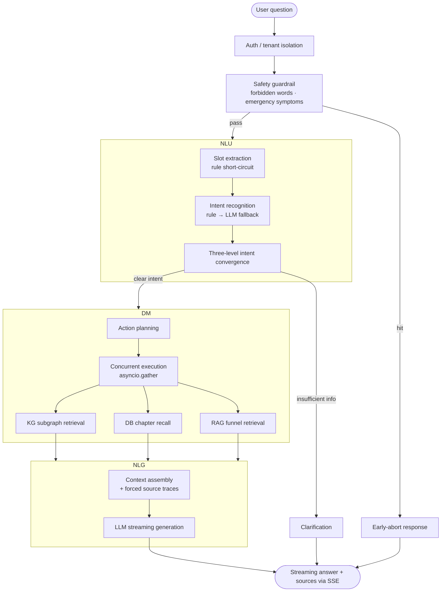
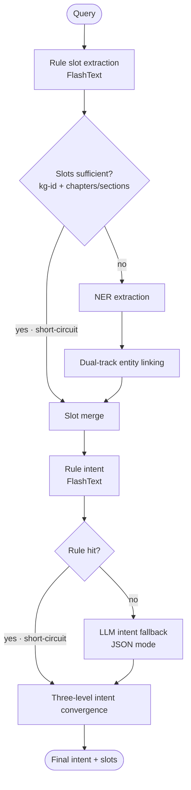
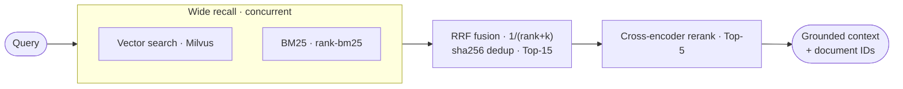
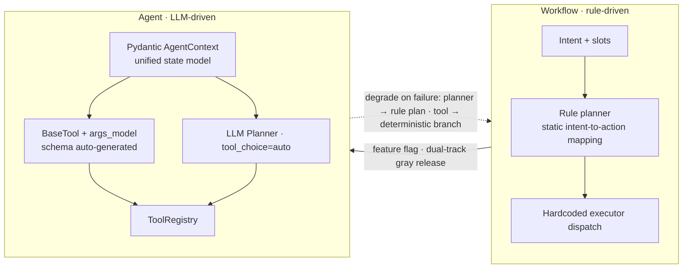

# Report Interpretation Agent — Online Conversational Report Interpretation, in Production

> A medical report-interpretation chatbot for the anti-aging product line — blood clock → methylation clock → imaging clock → multimodal clock — orchestrated as a streaming **NLU → DM → NLG** pipeline and live in the "九上阿" WeChat mini-program. **Rule-first NLU with LLM fallback**, **multi-source traceable retrieval**, **config-driven product expansion**, and a documented **Workflow → Agent** evolution.

[中文版](README_CN.md)

> **Proprietary notice.** The codebase behind this project is a private, company-internal implementation. This repository documents the work publicly — architecture, methodology, metric tables, and sanitized sample outputs. Source code is not published.

---

## What this is

This is the **online half** of a report-interpretation system: a conversational agent that reads a user's medical report and answers questions about it. A question passes through three stages — **NLU** (intent + slot understanding), **DM** (dialog management: plan which data sources to hit), **NLG** (assemble evidence, stream the answer with sources) — served over SSE to a WeChat mini-program.

Three mechanisms do the real work:

- **Config-driven expansion.** New report types (the product line ships blood clock → methylation clock → imaging clock → multimodal clock over time) are added by configuration, not code.
- **Hybrid NLU.** Rule matching short-circuits the fast path; an LLM only covers what rules miss — latency and cost meet recall.
- **Traceable retrieval.** Every answer is assembled from three isolated sources — a knowledge graph (KG), a vector/lexical search index (RAG), and the user's structured report in a database (DB) — and every answer carries its sources.

Its offline backbone — document chunking, golden-dataset construction, and pre-registered retrieval tuning — is documented separately in [RAG Offline Pipeline](../rag-offline-pipeline/).

## Why this matters

Medical report interpretation is a domain where a bare LLM fails in three specific ways, and each failure is a trust failure:

1. **Fabricated citations.** An answer that cites a paper that doesn't exist, or invents a reference range, is indistinguishable from a correct one to a patient — until it matters.
2. **Noise as evidence.** Generic wellness advice can be generated for anyone. A user hands over a report precisely because they want an answer about *their* findings. "Answered without reading the report" is the failure mode to engineer away.
3. **Silent failures.** When information is missing, an unconstrained model guesses. In this domain, "I can't find that metric" is the correct answer — and it has to be guaranteed by architecture, not by a prompt asking politely.

*The value is not generation — it is the orchestration engineering that makes answers personalized, traceable, safe, and fast.*

## At a glance

| Phase | Deliverable | Status |
|---|---|---|
| 1 · Rule-driven orchestration | Streaming NLU→DM→NLG pipeline over SSE; config-driven product expansion | In production use |
| 2 · Hybrid NLU + multi-source retrieval | Rule short-circuit + LLM fallback; RAG/KG/DB retrieval with forced source tracing; guardrails and tenant isolation | In production use |
| 3 · Workflow → Agent evolution | Pydantic state model, toolified executors with auto-generated function-calling schemas, LLM planner behind a feature flag | In production, dual-track |

---

## 1 · Three-stage streaming orchestration, config-driven

The request pipeline is deliberately boring — every stage has exactly one job, and every stage has a fallback:

**Config-driven product expansion** is the reason the multi-product roadmap (blood → methylation → imaging → multimodal clocks) is tractable. Configuration files cover, by role: intent keyword rules, metric alias dictionaries, per-report-type chapter/section structure with retrieval parameters, answer templates, prompts, interval-judgment logic, and a static copy library. Prompts are organized as a three-level tree — global defaults → per-report-type overrides → intent-specific variants — loaded along a `report type → stage → module → mode` path, so a new report type plugs in its own chapters, aliases, thresholds, and prompts without touching pipeline code.

Two rules the team learned the hard way and encoded: configuration is **loaded once into an immutable runtime snapshot** (a streaming response must never see its config change mid-flight; hot updates apply to new requests only), and nothing reads configuration files directly at request time.

## 2 · Hybrid NLU — rule short-circuit, LLM fallback

NLU is a two-track design at both the slot and intent layers: **FlashText** keyword matching runs first and short-circuits; an LLM (JSON-mode, confidence-thresholded) covers what rules miss. The measured spread — **~380 ms** rule-hit vs **~1.2 s** LLM-fallback — is the entire business case for the short-circuit.

The less obvious half is the **three-level intent convergence**, which is the system's architectural anti-hallucination device:

1. *Slot adjustment* — if the user asks about a metric the knowledge graph doesn't contain, `metric_explain` converges to `no_metric_explain`: the system says "not covered yet" instead of improvising an explanation.
2. *Report-state convergence* — a visitor with no report attached asking about report metrics gets scope-limited to product popularization, never a fabricated reading.
3. *Insufficient slots* — no metric and no chapter resolves to an explicit clarification question before any generation happens.

"Don't know, say so" and "ask instead of guessing" live in the routing layer — they cannot be prompt-engineered away.

## 3 · Multi-source retrieval — RAG funnel, KG subgraph, DB chapter recall

The DM dispatches three heterogeneous sources concurrently (`asyncio.gather`), each with the recall strategy that fits its data:

**RAG (product & domain knowledge)** — a three-stage funnel: dense vector search (Milvus) and BM25 run in parallel, fused with **RRF** (`1/(rank+k)`, sha256 content dedup) into a Top-15, then a cross-encoder reranks to a **Top-5**. Wide recall, one fusion, narrow precision — each stage has one job and a configurable width.

**KG (medical entities)** — dual-track entity linking: NER runs once, then metric entities link through online candidate recall + cosine re-verification (threshold 0.8), while chapter entities link against a **startup-precomputed chapter library held in memory** (threshold 0.6). The split follows data-change frequency: metrics are numerous and updated often, chapters are few and stable — stable data is precomputed once at boot, volatile data is queried online. Linked nodes expand into subgraphs, which are then cleaned by a three-stage dedup (by kg-id → by kg-id + node type → type-routed formatting into clinical significance / intervention / evidence / reference range / mechanism) and evidence cropped to the **Top-3 sources per answer**.

**DB (the user's own report)** — slot-extracted keywords map to report chapters/sections; recall tries exact section match first and falls back to chapter-level, then a configured pipeline picks interval-judged conclusions, dynamically composed text, or static copy.

The measured contrast for the vector store — **~120 ms warm vs ~250 ms cold** collections — is what the caching in §5 buys.

## 4 · Trust engineering — evidence, guardrails, privacy

- **Forced source tracing.** Retrieval results carry their provenance into the prompt: KG → paper titles + URLs, DB → report chapter names, RAG → document IDs. Answers render with a source panel — claims are checkable, by design, not by request.
- **Guardrails.** Forbidden-word screening via tokenized O(1) reverse-index lookup (not per-pattern regex); emergency-symptom questions abort early and route to medical advice; a disclaimer closes every answer.
- **Privacy.** Chat history lives in Redis with a 24 h TTL — never persisted to disk; guest mode is scope-limited by construction (no report → no report interpretation).
- **Multi-tenancy.** API keys with secure generation, expiry, daily quotas (429 on exhaustion), and `tenant_id`-bound data isolation — cross-tenant access rejection verified 4/4 in tests.

## 5 · Performance engineering & the degradation chain

Heavy resources (LLM clients, embedding models, graph/vector DB connections, retrievers, config) sit behind a **singleton registry with lazy loading**: first request pays 3–5 s of initialization, warm path runs at **~100 ms**. Retrievers are cached in two layers (connection-level and search-parameter-level) behind a double-checked lock; an LRU cache per report type took slot routing from **1200 ms to 600 ms**; the chapter library is precomputed once at startup and kept resident. Shutdown is graceful: signal → resource cleanup → trace flush, no leaked connections in containers.

The signature of production maturity here is the **full-stack degradation chain** — no single failure takes the service down, every layer degrades to a still-serving path:

- Planner failure → fall back to the deterministic rule planner
- Tool/executor failure → fall back to the deterministic execution branch
- Missing guardrail dictionaries → warning only, service still boots
- Observability outage → tracing degrades to no-ops, never interrupts requests

*Degradation is not "return 500" — it is "gracefully fall back to the next-best serving path."*

## 6 · Workflow → Agent evolution

The original DM was a rule planner mapping intent + slots to actions through a static mapping table. It worked in production, and it had known limits: high maintenance cost per new report type, no compositional reasoning, and executors that weren't callable as tools. The migration to LLM-driven decision-making was executed as an incremental, tested, dual-track evolution rather than a rewrite:

| Milestone | What changed | Tests |
|---|---|---|
| M0 / M1 | **Pydantic `AgentContext`** — a typed, validated state model replacing ad-hoc dicts; a single validated entry factory removed field drift | 6 / 12 passed |
| P0 (M3) | **Executor toolification** — executors wrapped as `BaseTool`s; function-calling schemas **generated from Pydantic arg models** (no hand-written JSON, no hallucinated parameters); a `ToolRegistry` as the single source of truth; results normalized to `ToolResult` | 19 passed |
| P1 | **LLM Planner** — function calling (`tool_choice=auto`, `temperature=0.1`) picks tools per turn, gated behind a feature flag; planning and execution each degrade to the rule pipeline on failure | 30 passed |

The interesting engineering judgment is in what was *not* done: no big-bang rewrite (each milestone shipped with passing tests and zero downstream regressions), no removal of the rule pipeline (it is the degradation net), and clarification deliberately kept out of the tool registry — asking is a planner decision, not a tool.

## Sanitized samples

| Sample | Link | What to look for |
|---|---|---|
| Side-by-side comparison (images + video) | [competitor-comparison.md](samples/competitor-comparison.md) | Same question, two systems: report-grounded personalization vs. generic advice; forced source tracing |
| Metric tables | [metrics.md](samples/metrics.md) | Measured latency decomposition vs. reported production figures — provenance labeled |
| Example dialogues | [example-dialogues.md](samples/example-dialogues.md) | Rewritten illustrations of five pipeline branches, not real conversations |

  

<video src="samples/media/report-interpretation-demo.mp4" controls width="360"></video>

The screenshots show the public mini-program and a third-party app (brand and user name masked); the video is a screen recording using the author's own test-report data. See the [desensitization statement](samples/README.md) for the full review record.

## Tech stack

Python · FastAPI + SSE · FlashText · qwen-series LLMs (DashScope, incl. embeddings & cross-encoder rerank) · Milvus · Neo4j · MySQL · Redis · rank-bm25 · jieba · Langfuse · uvicorn · Docker Compose

## Roadmap

- **M2** — strongly typed NLU contracts (intent/slot models), in progress
- **P2** — ReAct-lite feedback loop: allow one corrective tool call per turn, planned
- **P3** — retire the legacy static action-mapping configuration once the LLM planner track has fully proven out
- **M4** — tighten the context model to reject unknown fields (`extra=forbid`)

## Contact

For details or collaboration, see the repository root [README](../../README.md).
