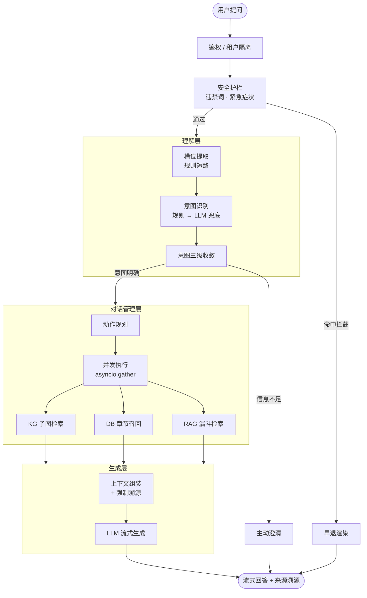
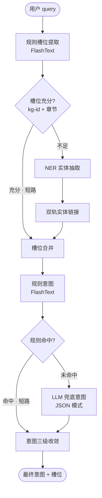
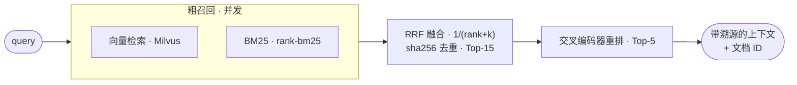
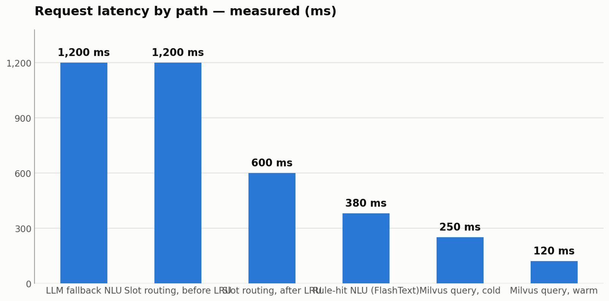
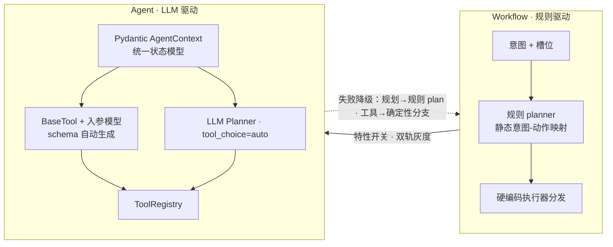
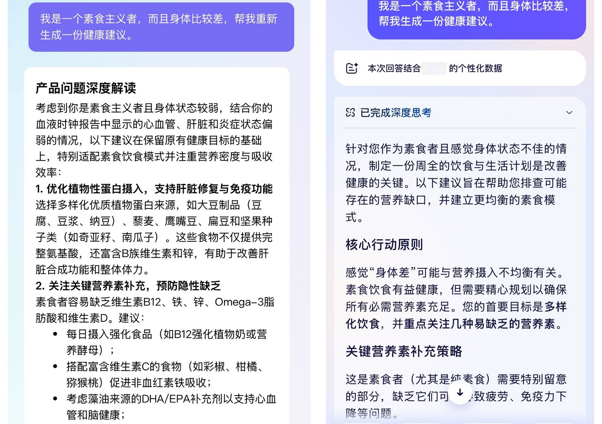
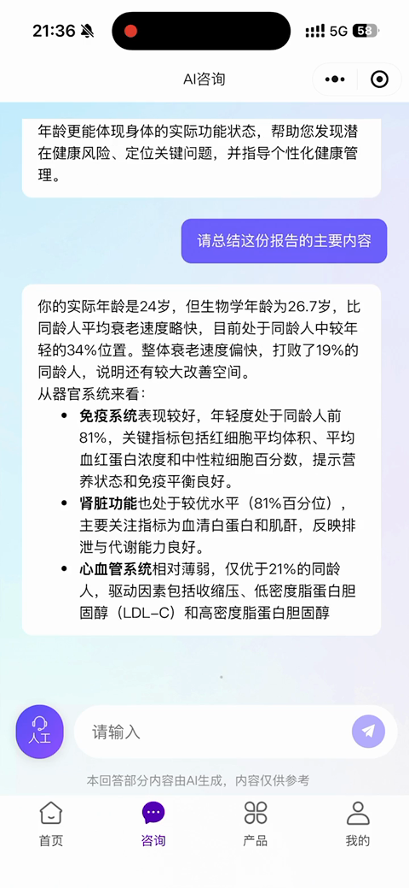

# 在线报告解读智能体 — 已投产的医学报告解读对话系统

> 面向抗衰产品线的医学报告解读对话智能体，**NLU → DM → NLG** 三阶段流式编排，已上线微信小程序「九上阿」。**规则优先、LLM 兜底**；**多源检索、全链路溯源**；新增报告类型**只改配置不改代码**。当前正从规则化 Workflow 向 LLM 自主决策的 Agent 架构演进。

[English](README.md)

> **脱敏声明**：本项目代码为公司内部私有实现，本仓库仅公开架构、方法论、指标数字与脱敏样本，源代码不公开。

---

## 一句话定位

用户上传医学报告（血液时钟 → 甲基化时钟 → 影像时钟 → 多模态时钟产品线），用自然语言提问，系统给出**锚定报告、附带溯源**的回答。一条问题经过三阶段：**NLU**（意图 + 槽位理解）→ **DM**（对话管理：规划该查哪些数据源）→ **NLG**（组装证据、流式输出、强制附来源），SSE 协议推送给小程序前端。

它是整个系统的**在线编排侧**；它的离线检索底座（切分、测评集构建、预注册检索调优）见 [RAG 离线系统](../rag-offline-pipeline/README_CN.md)——那边管数据质量，这边管在线编排。

## 为什么值得看

医学报告解读是"裸 LLM 不可用"的典型场景——**幻觉在这里不是体验问题，是医疗风险**：

1. **编造引用是信任崩塌的开始。** 引一篇不存在的文献、编一个参考范围，用户无法分辨——等发现时信任已经没了。
2. **不看报告的解读等于没解读。** 泛化建议任何聊天机器人都能给；用户把报告递过来，要的是"结合我的报告"的答案。
3. **信息不足硬答 = 静默失败。** "查不到就明说、信息不足就追问"必须做在**架构层**（意图收敛），不能指望 Prompt 里写一句"不知道就说不知道"。

这套系统同时考验两件事：**LLM Agent 工程**（编排、延迟、降级、可观测、演进）与**业务理解**（医学报告的溯源、合规、个性化）。

## 三阶段

| 阶段 | 交付物 | 状态 |
|---|---|---|
| 阶段一 | 规则化编排上线：三阶段流式管线 + 配置驱动多产品扩展 | 已投产 |
| 阶段二 | 混合 NLU + 多源可溯源检索 + 安全合规工程 | 已投产 |
| 阶段三 | Workflow→Agent 演进：Pydantic 状态模型 + 工具化执行器 + LLM Planner 灰度 | 已投产，双轨灰度中 |

---

## 亮点一 · 配置驱动：改 YAML 不改代码

多产品路线图（血液 → 甲基化 → 影像 → 多模态时钟）能落地，靠的是**所有会变的东西都外置到配置**：意图关键词规则、指标别名词典、各报告类型的章节结构与检索参数、回答模板、Prompt（三级结构：全局默认 → 报告类型覆盖 → 意图专属变体，按 `报告类型 → 阶段 → 模块 → 模式` 四级路径加载）、区间判定逻辑、静态文案库。新增一个报告类型 = 配好它自己的章节、别名、阈值与 Prompt，**不动一行管线代码**。

两条踩坑换来的规矩：配置**一次性加载为不可变运行时快照**（流式响应中途绝不允许配置变化，热更新只作用于新请求）；任何模块**不得在请求时直接读配置文件**。

## 亮点二 · 混合 NLU：规则短路 + LLM 兜底 + 意图三级收敛

意图与槽位两层都是**双轨**：FlashText 关键词规则先跑、命中即短路；未命中才走 LLM（JSON 模式 + 置信度阈值）。实测差距——**规则命中 ~380ms vs LLM 兜底 ~1.2s**——就是短路的全部商业理由。

真正见功力的是**意图三级收敛**，这是系统级的抗幻觉装置：

1. **按槽位调整**——问了一个知识图谱里没有的指标，`metric_explain` 收敛为 `no_metric_explain`：明说"暂未收录"，而不是硬编一个解释；
2. **按报告状态收敛**——没绑报告的访客问报告指标，收敛为产品科普，绝不虚构一份读数；
3. **信息不足转澄清**——没有指标也没有章节，生成前先追问。

## 亮点三 · 多源检索：各扬所长 + 并发调度

DM 层用 `asyncio.gather` **并发**调度三路异构数据源，每路用最适合自己数据的召回策略：

- **RAG（产品与领域知识）**——三级漏斗：向量检索（Milvus）与 BM25 并行召回 → **RRF**（`1/(rank+k)` 融合 + 内容 sha256 去重）取 Top-15 → 交叉编码器精排 **Top-5**。粗召回宽、融合去偏、精排收窄，每级一个职责，宽度可配置。
- **KG（医学实体）**——双轨实体链接：NER 只跑一次，指标实体走"在线候选召回 + 余弦二次校验"（阈值 0.8），章节实体走"**启动预计算章节库常驻内存**"（阈值 0.6）。取舍逻辑：指标多而常变 → 在线检索；章节少而稳定 → 启动预计算，近 O(1) 标准化。子图召回后**三段去重**（按 kg-id → 按 kg-id+节点类型 → 按类型分流成"临床意义/干预/证据/参考范围/机制"），证据裁剪为每回答 **Top-3**。
- **DB（用户自己的报告）**——槽位关键词映射报告章节；先章节精确匹配、再章节级兜底；配置化流水线决定取"区间判定结论 / 动态组合文本 / 静态文案"。

向量库实测对比——**热集合 ~120ms vs 冷集合 ~250ms**——就是亮点四缓存买回来的东西。

## 亮点四 · 性能工程 + 全栈降级链

重资源（LLM 客户端、嵌入模型、图/向量库连接、检索器、配置）全部收进**单例注册表 + 懒加载**：首请求 3–5s 一次性初始化，温路径 **~100ms**。检索器两层缓存 + 双重检查锁；按报告类型的 LRU 缓存把槽位路由从 **1200ms 压到 600ms**；章节向量启动预计算常驻内存；优雅停机（信号 → 资源释放 → trace 冲刷），容器里不留泄漏连接。

最能体现生产成熟度的是**全栈降级链**——任何单点故障都不让服务裸奔，每一层都退到一个仍能服务的次优路径：

- 规划层失败 → 回退确定性规则 planner
- 工具/执行器失败 → 回退确定性执行分支
- 护栏词库缺失 → 仅告警，服务照常启动
- 可观测故障 → 埋点退化为 no-op，绝不中断主流程

*降级不是"报 500"，是"优雅退化到次优但可用的路径"。*

## 亮点五 · Workflow → Agent 演进（压轴）

原版 DM 是规则 planner：意图+槽位查静态映射表得到动作。它在生产上能跑，但边界清晰：新报告类型维护成本高、没有组合推理能力、执行器不是工具。向 LLM 自主决策的迁移被做成**增量、带测试、双轨灰度**的演进，而不是重写：

| 里程碑 | 改动 | 测试 |
|---|---|---|
| M0 / M1 | **Pydantic `AgentContext`** 统一状态模型替代裸 dict，入口统一校验，消除字段漂移 | 6 / 12 passed |
| P0（M3） | **执行器工具化**：`BaseTool` 封装；Function-Calling schema **由 Pydantic 入参模型自动生成**（不手写 JSON、防幻觉参数）；`ToolRegistry` 单一事实来源；结果规范化 `ToolResult` | 19 passed |
| P1 | **LLM Planner**：函数调用自主选工具（`tool_choice=auto`、`temperature=0.1`），特性开关灰度；规划与执行两层失败均降级回规则管线 | 30 passed |

工程判断体现在**没做的事**上：不做大爆炸重写（每个里程碑带测试交付、下游零回归）；不删规则管线（它是降级网）；澄清刻意不进工具注册表——**追问是规划决策，不是工具**。

## 脱敏声明与样本

| 样本 | 链接 | 看什么 |
|---|---|---|
| 同题对比（图文 + 视频） | [competitor-comparison_CN.md](samples/competitor-comparison_CN.md) | 同一问题两套系统：锚定报告的个性化 vs. 泛化建议；强制溯源 |
| 指标表 | [metrics_CN.md](samples/metrics_CN.md) | 实测延迟分解 vs. 生产上报口径——出处分层标注 |
| 问答示例 | [example-dialogues_CN.md](samples/example-dialogues_CN.md) | 五个管线分支的改写示意，非真实对话 |

  

截图展示公开小程序与第三方 App（品牌与用户名已打码）；视频为作者本人测试数据录屏。完整审查记录见[脱敏声明](samples/README_CN.md)。生产规模数字（DAU/QPS/TTFT）为运营上报口径，见指标表的方向性标注。

## 技术栈

Python · FastAPI + SSE · FlashText · qwen 系列 LLM（DashScope，含嵌入与交叉编码器重排） · Milvus · Neo4j · MySQL · Redis · rank-bm25 · jieba · Langfuse · uvicorn · Docker Compose

## Roadmap

- **M2** — NLU 强类型契约（意图/槽位模型），进行中
- **P2** — ReAct-lite 反馈闭环：每轮允许一次纠错性工具调用，规划中
- **P3** — 规则映射配置退役：LLM planner 轨充分验证后废弃静态动作映射
- **M4** — 上下文模型收紧 `extra=forbid`

## 联系

合作与交流请见仓库根目录 [README](../../README_CN.md)。
