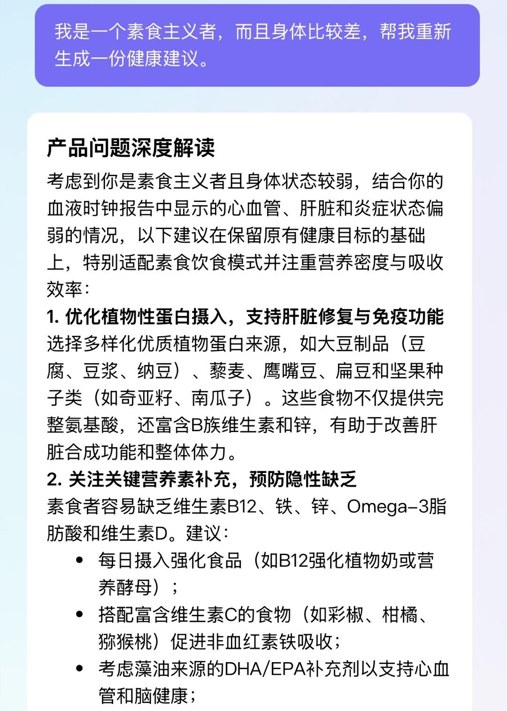
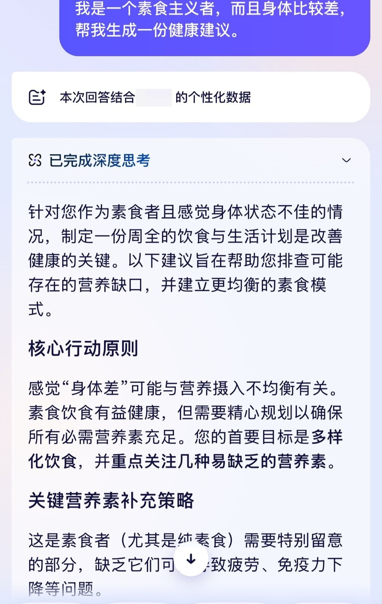
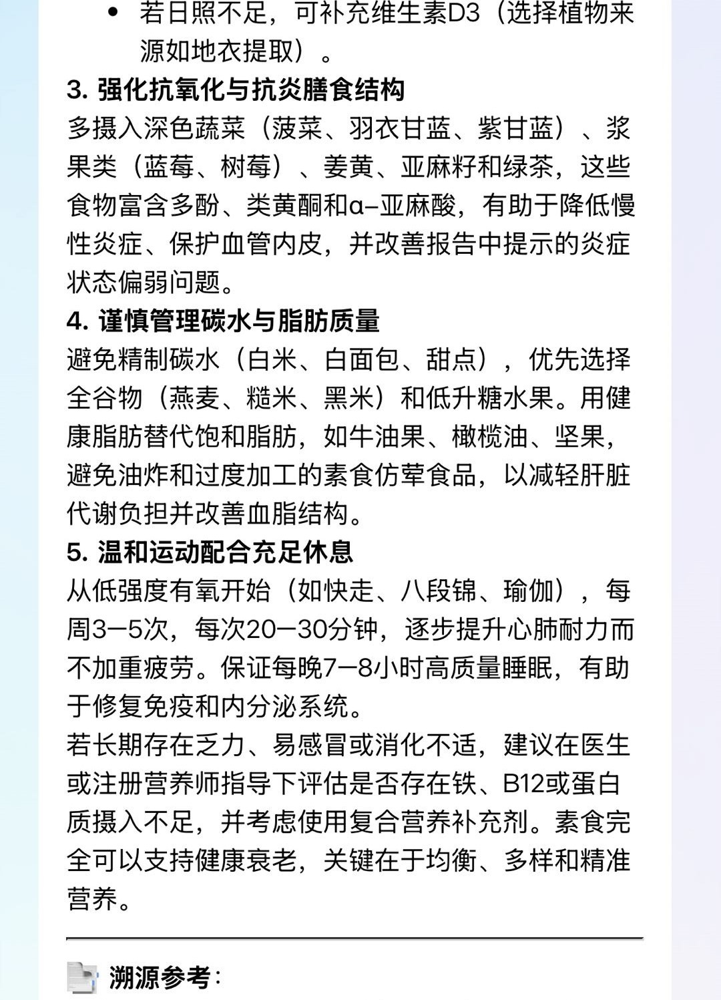
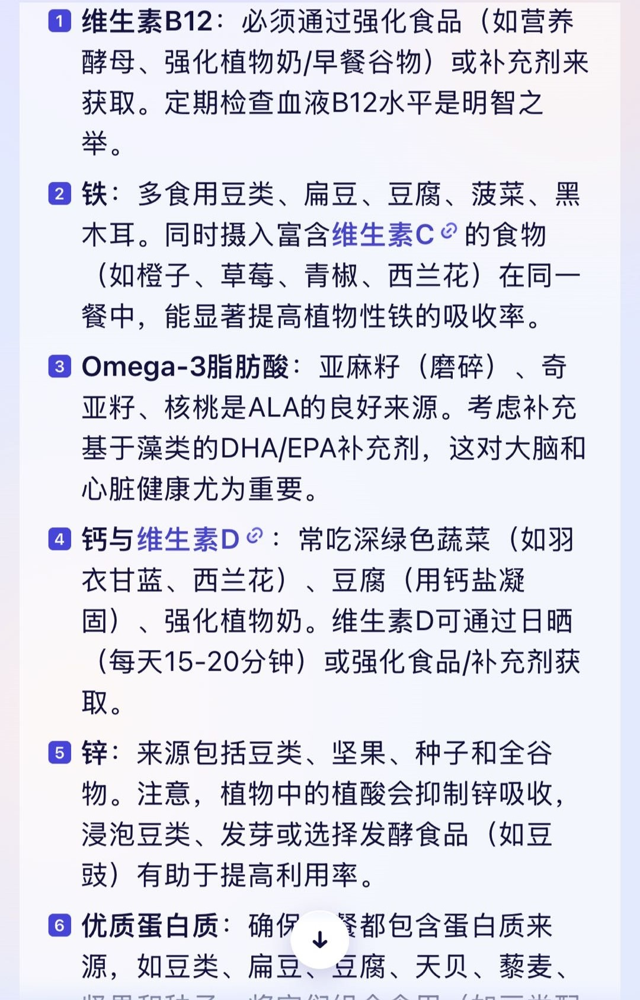
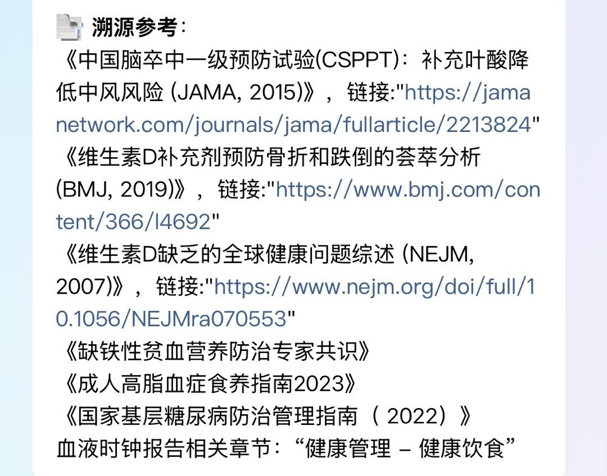
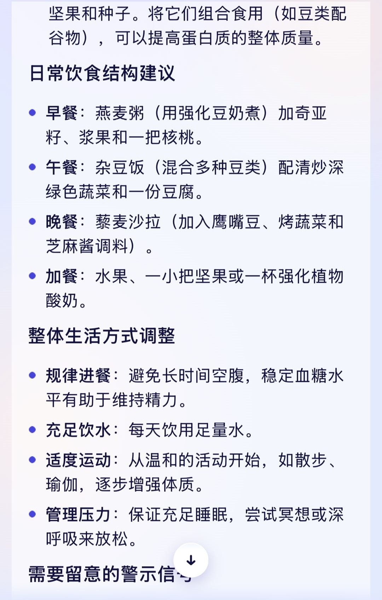
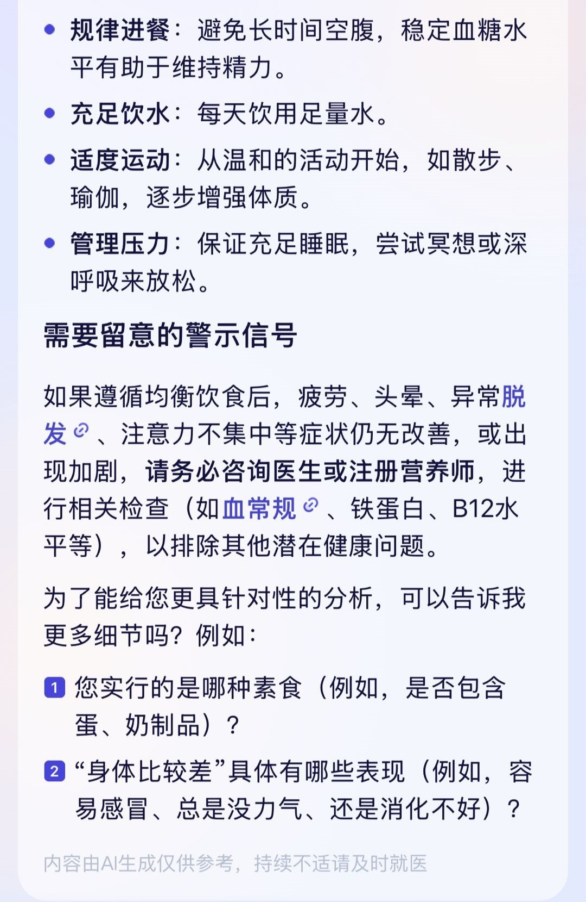

# Side-by-Side: Report-Grounded Personalization vs. Generic Advice

**Method note.** The same question was asked once to the "九上阿" WeChat mini-program (left) and once to a third-party consumer app (right):

> "I'm a vegetarian and in poor physical shape — please regenerate a health plan for me."
> *(original in Chinese, see the screenshots)*

This is a **single same-question observation (anecdotal), not a benchmark**. The third-party app is deliberately not named; its brand marks and an in-app user name were masked. Screenshots are shown solely to illustrate one behavioral contrast: answers anchored to the user's own report data and literature, versus generic wellness advice.

## The contrast in four captures

| # | Ours — "九上阿" mini-program | Third-party app (brand masked) |
|---|---|---|
| 1 |  The answer opens by grounding itself in the user's **blood-clock report**: cardiovascular, liver, and inflammation status all flagged as weak — the diet plan is built around those findings. |  A well-structured but **generic** vegetarian nutrition plan; the app states it used "personalized data" but the advice does not reference any specific report findings. |
| 2 |  Supplementation, exercise, and sleep advice continues to map back to the report's weak systems — each recommendation is tied to a finding. |  A generic nutrient-supplement checklist (B12, iron, omega-3, calcium, zinc). |
| 3 |  A **source-tracing panel** closes the answer: paper titles with links (*JAMA* 2015, *BMJ* 2019, *NEJM* 2007, national clinical guidelines) plus the specific report chapter the advice drew from. |  Generic meal-structure suggestions (breakfast/lunch/dinner templates). |
| 4 | — |  The third-party app ends by **asking clarifying follow-ups** (which vegetarian type, which symptoms). To be fair: proactive clarification is a capability both systems share — ours does it before answering when slots are missing; this capture simply shows the contrast in the same session. |

## Live demo (video)

A 27-second screen recording of the mini-program: the first half shows **guest mode** — a visitor without a report gets a product introduction (scope-limited to general science popularization). The second half shows **report mode** — after attaching a blood-clock report, the same product answers with the user's biological-age results, organ-system percentiles, and personalized, streamed recommendations.

## What to look for

1. **Report grounding** — one system's advice names the user's actual weak systems and builds on them; the other delivers advice that would be identical for any user. "Read the report" versus "answered without reading the report" is the entire difference.
2. **Verifiable sources** — the source panel turns every claim into something the user can check: journal links and the report chapter, not just assertions.
3. **Mode scoping** — guest mode explains the product; report mode interprets the report. Scope is decided before generation, not inside a prompt.

*Desensitization: third-party brand and user name masked; our screenshots show the public mini-program with the author's own test data. See the [desensitization statement](README.md).*
